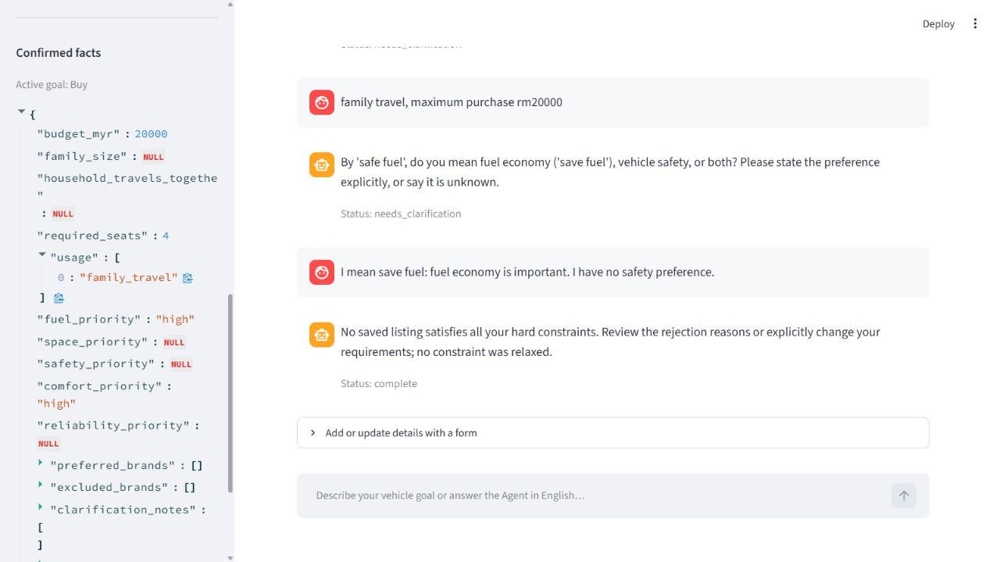

# Buy 重复追问与偏好澄清修复

日期：2026-10-26。这次接着处理用户真实报告的 Buy 对话；22 Oct 的用途／表单修复和 Kaggle 研究记录仍保留。

## 发生了什么

用户先输入：

```text
I want to buy a car. i want a car with 4 seat, for travel use, comfortable, safe fuel
```

再回答：

```text
family travel, maximum purchase rm20000
```

修复前，第一轮产生用途检查错误后，旧错误会阻止 Python 在第二轮补回原文中的 `family travel`。因此预算更新了，用途却仍为空，Agent 再问用途。22 Oct 保存的真实模型重放确认了这个情况；不会把该记录写成26 Oct新运行。

另外，`safe fuel` 有歧义：可能是 `save fuel`（省油）的拼写，也可能在说安全。此前模型同时填高省油与高安全，原句不足以支持这个判断。真实验证还发现模型把 `no safety preference` 返回成错误的选项值，造成另一轮不必要追问。

## 已改的行为

- 当前消息明确说 `family travel`、`long distance travel` 或通勤时，即使模型漏提取或之前留有用途错误，Python 也能按原文补回并结束旧用途问题。无关内容或否定说法不会解除问题。
- 仅说 `travel` 时，记下这个原词并在侧栏显示“待确认类别”，不擅自猜成家庭出游或长途。回答明确类别后移除待确认提示。
- 错误的模型用途标签不会抹掉用户已确认的其他用途；新增与明确替换仍分别处理。
- `safe fuel` 会询问含义；四座、舒适和预算等已明确资料继续保留。可以回答 `Both please.`，但只有它是唯一待答选择时才接受这样的简短回答。
- `no safety preference` 等明确、带名称的“没有偏好”，由 Python 按原文清空对应偏好；不依赖模型必须正确返回 JSON `null`，也不会清空别的偏好。
- 聊天与辅助表单都能解决同一个省油／安全问题。单独修改预算的表单不会误解除偏好问题。
- 延续22 Oct的 `Driving use` 多选表单：无需输入逗号；非空选择替换旧用途，留空保留，单独选Unknown清空。

这些是有限范围的英语识别规则，不能保证所有表达方式都能正确理解。模型异常、单位／货币冲突和超时仍必须保留并处理。

## 怎样亲手检查

先导出需要保留的会话，在运行网页的PowerShell里按 `Ctrl+C`。进入项目目录，重新启动：

```powershell
.\.venv\Scripts\python.exe -m streamlit run streamlit_app.py
```

刷新浏览器，选择Buy并开始新咨询。依次输入上面的两句，再输入：

```text
I mean save fuel: fuel economy is important. I have no safety preference.
```

| 轮次 | 应观察到的结果 |
|---|---|
| 第一轮 | 保存至少4座、舒适偏好；追问用途类别、预算及 `safe fuel` 的意思 |
| 第二轮 | 保存 `family_travel` 与RM20000；不再问用途，只保留省油／安全含义的追问 |
| 第三轮 | 省油为high、安全偏好为未知／未指定；保留4座与舒适；执行筛选并检查结果 |

本次现有快照返回 `no_matches` 是符合资料的结果。17条记录中11条是listed snapshot（当时仍刊登的快照），其中最低挂牌价为RM35888；因此没有符合RM20000的候选。不能把这个结果说成马来西亚市场没有RM20000汽车。

`4 seat` 在这里解释为**至少4座**，5座或7座也可满足座位要求。`complete` 表示这轮查询已完成，不代表成功找到车或执行交易。没有匹配时，用户仍可明确修改条件继续咨询。

## 验证记录怎么读

新增19项针对性检查，包含旧错误恢复、用途增补与否定、原词提示、偏好澄清、表单、无匹配及修改预算后重新筛选。最终全套离线结果和真实模型逐轮结果以[本次机器记录](docs/buy-followup-20261026.json)为准；模型回复脚本化的离线检查和实际Ollama运行分开记载。

| 最终检查 | 本次实际结果 |
|---|---|
| 全套离线测试 | 232项通过，20.804秒，0 failures／errors／skipped |
| 最终代码的真实Ollama顺序重放 | 三轮通过，27.51／20.99／30.31秒；第二轮仅剩偏好含义问题，第三轮complete／no_matches |
| 结果检查器 | 第三轮12项检查全部通过；RM20000与至少4座条件未放宽 |
| 版本对应 | 最终离线与真实重放的代码／资料SHA256一致；之后只更新文档与证据 |

原始最终报告分别是本机 `team_results/buy-followup-20261026-final-offline-v3.json` 和 `team_results/buy-followup-20261026-after-v4-final.json`，摘要记录其文件指纹。这是Ryan电脑上的开发验证，不是组员独立评估或跨电脑复现。

真实网页已完成三轮，第二轮没有再问用途，第三轮完成查询。随后增加两项表单澄清边界测试及对应修复；最终离线测试覆盖这一修改，真实模型另做最终顺序重放。截图保存的是网页三轮检查时的状态，不冒充最后小改后的第二次完整网页验收。手动导出下载本轮未重新测试。



中途出现过一次 `no safety preference` 的模型标签错误、一次同时测试时的模型请求超时。原始记录保存在本机 `team_results/`，摘要保留其状态和文件指纹，不把失败改成通过。后续顺序重放另存报告，代码／资料指纹可用于确认测试针对哪个版本。

本轮没有增加当前库存、改变价格政策或训练回归。Malaysia Resale Carlist 的接入方式见[资料说明](DATA_IMPORT_PLAN_ZH.md)：当前保留研究原件，候选转换与规格核实仍待实施。无需安装新的软件。以上验收发生在Git交付之前，保留当时的源文件与报告指纹；后续交付版本以仓库提交记录为准。
