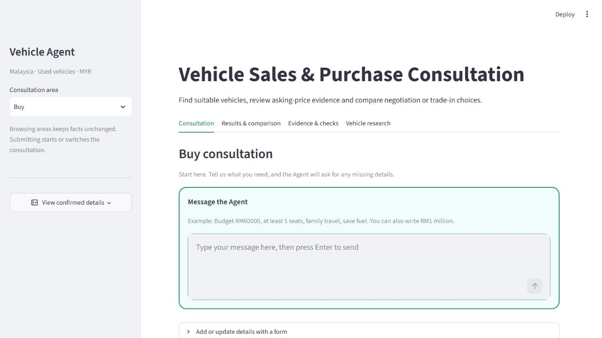

# 聊天输入、已确认需求与金额指引

更新：2026-10-26。本次在移除原快照侧栏之后，继续按用户截图改善使用体验。

## 怎样开始

进入Consultation，在砖红色边框的 **Message the Agent** 输入框输入英文，按Enter发送。辅助表单默认收起，需要逐项修改时才展开。

侧栏的 **View confirmed details** 按钮用于查看当前会话已经记住的预算、座位、用途、车型或报价等资料。资料由聊天／表单经过Controller检查后自动更新，不需要再按一次保存。按钮显示易读标签与单位；打开它不执行模型、不更新需求，也不会把资料永久写入硬盘。换咨询可在聊天发送 `/reset`。

## 1 million 可以输入吗

可以。预算是用户愿意支付的最高金额，和数据库中有没有恰好相同价格的车没有关系。RM1000000可以筛选比它便宜、也满足其他硬条件的车辆；这不表示系统有百万级车型。

| 输入位置 | 例子 | 处理 |
|---|---|---|
| 聊天 | `My maximum budget is RM1 million.` | 记录MYR1000000 |
| 聊天 | `My budget is MYR1m.`／`RM1000k` | 同样记录MYR1000000 |
| 表单MYR金额栏 | `1million`、`1 million`、`1,000,000`、`1000k` | 同样解析为1000000；栏位已经说明币种 |
| 聊天 | `My budget is 1million.` | 询问RM／MYR，并给可复制例子；不默默推定货币 |
| 聊天或表单 | 外币、`1e6`、`1billion`等未支持格式 | 提示明确金额写法；不截成1，也不兑换外币 |
| 金额 | 超过两位小数、不合理负数或零预算 | 拒绝并指出对应栏位和可接受写法；已知零费用仍允许 |

金额的 `m` 简写只用于money解析；里程的 `900 m` 仍换算成0.9km。新的货币解析与距离单位分别处理。

明确修改预算但新输入不合规则时，会要求澄清，不继续用旧预算出推荐。座位与用途等其他已确认资料继续保留。系统会核对完整预算原句，避免模型把 `RM1 million` 的证据截成 `RM1` 后误存为1。

这些是明确范围内的英语金额规则，不是对所有自然语言写法都正确的保证。仍需记录新的错误案例。

## 资料库没有匹配时

没有匹配会给出可操作提示：在聊天或表单修改预算、最少座位或排除品牌，并可查看具体拒绝原因。系统不会自动放宽条件。

偏好品牌是软条件：如符合硬条件的保存资料里没有该品牌，Results会说明，并展示其他合格品牌；用户的偏好仍保留。未知车型规格或评分数据也继续显示Unknown，不会由语言模型补造。

本次不添加库存、不刷新市场价格、不训练回归。来源和日期仍在结果与证据里保存。运行与测试记录见 [本次证据](docs/input-guidance-20261026.json)；此前界面截图与验证记录属于当时版本。

## 本次实际检查

- 242项离线测试通过，14.036秒，0 failures／errors／skipped；其中10项新增金额测试验证单位、完整数值、外币／非法格式、旧预算失效和真实匹配工具。
- 真实浏览器／Ollama完成三轮：聊天RM1 million正常推荐 → 聊天1million缺币种时追问并显示示例 → MYR表单1million补正后正常推荐。座位5与Family travel保留。
- 中间另外在表单输入1billion，页面本地拒绝并显示60000／60k／1 million示例；没有把它作为已确认金额。
- 按钮展开显示MYR1,000,000.00、5座及家庭出游；Results显示当前经过检查的车辆卡片。未另外运行CLI模型重放，未声称独立评估。
- 最终代码／资料指纹与离线报告一致。上述验收在后续Git交付前完成，原报告保留当时的源文件与运行记录；交付版本以仓库提交记录为准。

[查看百万预算与需求按钮的实际截图](docs/input-guidance-million-20261026.png) · [查看缺币种时的提示截图](docs/input-guidance-help-20261026.png)

## 后续配色更新

同日按用户提供的四种颜色更新网页：`#B80C09`用于主要按钮、选中状态及输入框强调，`#6B2B06`用于标题和提示，`#E5E7E6`用于主背景，`#B7B5B3`用于侧栏与辅助边框；输入卡片保留白色以区分填写区域。

本次仅配色，19项现有界面相关测试通过（8.315秒）；实际浏览器核对标题深棕、主提交按钮砖红／白字及表单展开，并检查主要配色的文字对比。没有重复模型推理或声称重新运行完整242项。[配色证据](docs/palette-20261026.json)及[新网页截图](docs/palette-20261026.png)对应当前外观，前面的截图保留当时版本。
