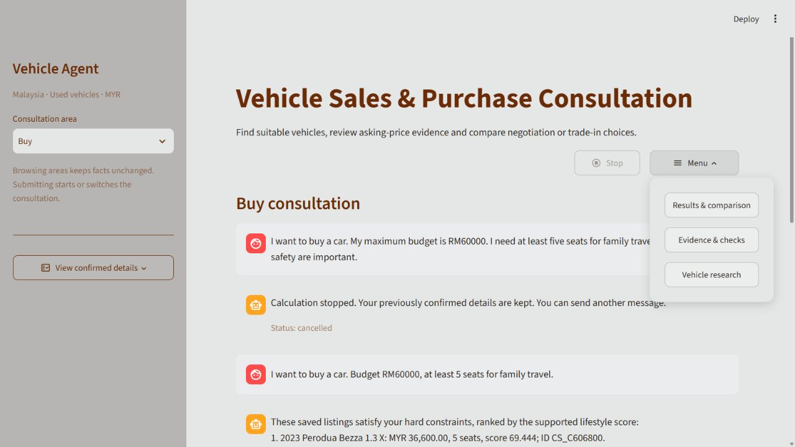

# 右侧菜单与正在计算时的Stop

更新：2026-10-26。本次修改实际Agent网页。

## 页面怎样使用

主画面保留Consultation聊天。右侧三条杠的 **Menu** 打开三个入口：Results & comparison、Evidence & checks、Vehicle research。其他页面用 **Back to consultation** 返回。导航只查看资料，不提交新的咨询。

右侧 **Stop** 在正在计算时可点击，空闲时为灰色。按下后会停止本次任务，页面显示cancelled并恢复输入；之前已确认的资料保留。本轮尚未完成的新资料与结果不会作为已确认内容发布。之后可直接发送新消息。

## 为什么要改停止机制

原生Streamlit Stop主要在脚本执行到可中断的位置时生效；旧代码长时间等待本地模型，不能保证按钮马上打断等待。本次以项目自己的Stop统一控制，隐藏框架独立的script-only运行控件，避免两个Stop有不同含义。

现在一轮咨询在独立后台任务里运行，界面持续响应取消。任务使用当前会话的副本，完成后才发布。本地Ollama请求使用streaming HTTP，父进程每50ms检查取消；收到取消后终止自己创建的请求工作进程并关闭连接，Controller不再重试或开始后续工具。共享模型锁会释放。

这相当于中断**当前咨询计算**，不会对整个PowerShell执行Ctrl+C，也不会关闭Streamlit／Ollama服务或其他应用。Ollama模型仍可能驻留显存作为缓存，不能据此认定被取消的请求仍在生成。

本次工具都是有限的本地计算。取消在工具开始前和返回后也会检查；这不是对未来任意第三方阻塞函数的强制终止保证。模型进程清理和界面更新各需要短暂时间，不承诺任何电脑都能零毫秒响应。

实现依据：[Streamlit fragments](https://docs.streamlit.io/develop/api-reference/execution-flow/st.fragment)、[Ollama维护者对中断HTTP连接的说明](https://github.com/ollama/ollama/issues/5694)、[Ollama API与keep_alive](https://github.com/ollama/ollama/blob/main/docs/api.md)。最终行为以本机实际验证为准，没有因官方说明便直接假定成功。

## 本次实际验证

- 全套250项离线测试通过，26.238秒；含8项新增取消／导航检查。首次全套发现旧研究页面测试仍直接找标签页控件；改为通过Menu导航后通过，首次失败记录保留。
- 真实qwen3:4b请求已收到第一个stream chunk后取消，请求工作进程在0.078秒内退出；PID不再存活、模型锁释放、原RM60000需求保留。之后新的RM50000请求正常完成，结果检查全部通过。
- 真实网页点击Stop：显示cancelled，输入恢复，结果页没有本轮未完成结果。菜单展开显示三个入口；停止后再次提交正常咨询也实际检查。
- 0.078秒是发出取消信号至请求工作进程结束的本机测量，**不是浏览器点击、网络往返及界面刷新总延迟**，也不是所有硬件的保证。

原始结果在本机team_results/；[本次摘要](docs/stop-menu-20261026.json)记录来源指纹与范围。真实模型测试后只调整菜单宽度并适配旧测试导航；最终测试及实际网页针对最终界面。取消涉及的Controller／UISession代码没有在真实模型验证后更改。

更新后请在原PowerShell窗口按Ctrl+C，重新启动Streamlit并刷新网页，确保新后台任务代码已加载。本文验收在后续Git交付前完成，原始报告保留当时的源文件指纹；交付版本以仓库提交记录为准。
